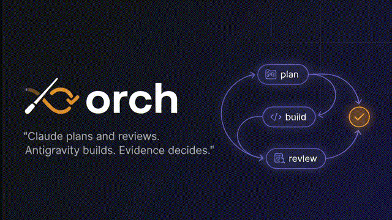
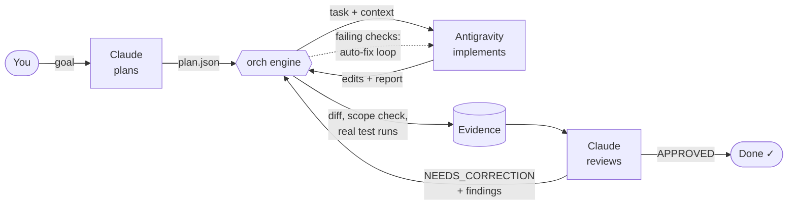

<p align="center">
  
</p>

<p align="center">
  A local orchestration engine that turns <b>Claude Code</b> into an engineering lead and <b>Antigravity</b> into its implementation team, with every result checked against real diffs and real test runs.
</p>

<p align="center">
  <a href="https://github.com/federicoalbanese/orch/actions/workflows/ci.yml"></a>
  
  
  
  <a href="LICENSE"></a>
</p>

---

## Why orch?

Coding agents are fast, and they also fail in predictable ways:

- 🫥 **They claim success without proof.** "All tests pass" when no test ever ran.
- 🌀 **They drift.** A one-line fix arrives with a refactor of three unrelated files.
- 📋 **You become the glue.** You copy prompts between tools, re-explain context, and chase down what actually changed.

orch splits the work the way a good engineering team does:

| Role | Who | Responsibility |
|---|---|---|
| 🧠 **Lead** | Claude (Claude Code) | Understands the request, inspects the code, designs the solution, writes precise tasks with acceptance criteria, **reviews the evidence**, and requests corrections |
| 🛠️ **Implementer** | Antigravity (`agy` CLI) | Implements one well-scoped task at a time and reports back in a strict format |
| ⚖️ **Referee** | The `orch` engine | Keeps state, enforces policy, dispatches tasks, snapshots and diffs the repository, **runs the tests itself**, and refuses approvals the evidence doesn't support |

You set goals and approve the important decisions. That's it.

## How it works



1. **Plan.** Claude inspects the repository and writes a plan: small tasks, each with an allowed scope, concrete instructions, and verifiable acceptance criteria. orch validates it (schema, dependency cycles, scope paths, unknown commands) and applies approval policy.
2. **Dispatch.** orch snapshots the working tree, sends the task to Antigravity with layered project context, and streams progress.
3. **Verify.** orch diffs exactly what changed, flags anything outside the task's scope or touching sensitive files, and **runs the project's confirmed test and lint commands itself**. If checks fail, it sends the failure output straight back to Antigravity, up to twice, without spending Claude tokens.
4. **Review.** Claude reads the evidence bundle and decides: `APPROVED`, `NEEDS_CORRECTION`, `BLOCKED`, or `NEEDS_HUMAN_APPROVAL`. A correction resumes the same Antigravity conversation, with the original task and every earlier finding.
5. **Repeat** until approved, or until the cycle limit escalates the task to you.

## Highlights

- ✅ **Evidence over claims.** Tests are run by the engine, never trusted from the agent's report. `APPROVED` is refused while any check failed, scope was violated, or a criterion is unmet.
- 🔒 **Safety in code, not in prompts.** Force-push, production deploys, discarding your changes, and sending a repository's code to an external engine can never be made automatic. Agents can't record themselves as you.
- 🧭 **Universal.** Stack discovery for PHP/Laravel, Node, Go, Python, Rust, Dart/Flutter, Java/Kotlin and Ruby, plus Makefiles and Docker Compose. Commands that only run in containers get container commands proposed.
- 🧾 **Auditable.** SQLite state with an append-only event log. Every status change has an actor and a reason.
- 🧠 **Project memory with provenance.** Knowledge entries record their source and the commit they were verified at, and go stale automatically when the files they describe change.
- 🔁 **Resilient.** Retry with backoff for rate limits, cancellation from any terminal, crash recovery that keeps the dead run's edits attributed, tolerance of corrupted executor output, and a manual fallback that hands the prompt to the Antigravity desktop app.
- 📝 **Commits only what was reviewed.** `orch task commit` commits exactly an approved task's own files, after your OK. It never pushes and never adds `Co-Authored-By` trailers.
- 📦 **Zero dependencies.** Standard-library Python 3.11+. Nothing to install but the tool itself.

## Requirements

| | |
|---|---|
| **Python** | 3.11 or newer |
| **git** | Any recent version |
| **Claude Code** | Plans, reviews and drives orch through the bundled skill |
| **Antigravity CLI (`agy`)** | Signed in, with access to Antigravity for your Google account |
| **OS** | Linux or macOS |

## Installation

```bash
pipx install git+https://github.com/federicoalbanese/orch.git
```

```bash
orch init && orch doctor
```

`orch doctor --probe` also checks that your Google account can use Antigravity. It sends one tiny read-only request (no code), and tells location, licence, eligibility and rate-limit problems apart.

```bash
orch skill install
```

The last command installs the **`orchestrate`** skill into `~/.claude/skills/`, so Claude Code knows how to drive orch.

Then add this to `~/.claude/settings.json`, so the engine records Claude's actions as Claude's and refuses the steps reserved for you:

```json
{
  "env": { "ORCH_ACTOR": "claude" }
}
```

## Quick start

In Claude Code, describe what you want:

> *"Use orch on ~/code/shop: add percentage discount codes to the cart, with tests."*

Claude takes it from there:
1. Discovers and registers the project.
2. Asks you to confirm the test and lint commands, and to opt the project in to Antigravity.
3. Writes and imports a plan.
4. Dispatches tasks, reviews the evidence, and sends corrections until everything is approved.

You only step in for the actions reserved for you:

```bash
orch project command confirm shop    # trust the discovered test/lint commands
orch project engine shop --allow     # allow this repo's code to be sent to Antigravity
orch plan approve P1 --reason "..."  # only when a plan needs approval
orch task commit P1.T1               # commit an approved task's files (Claude prepares it with --dry-run)
orch status                          # what's waiting on you, in review, running, ready
```

<details>
<summary><b>Driving orch by hand</b></summary>

```bash
orch project discover ~/code/shop        # read-only inspection, saves nothing
orch project add ~/code/shop
orch schema plan > plan-schema.json      # the plan contract
orch plan import plan.json
orch run --project shop                  # dispatch → evidence → auto-fix → IN_REVIEW
orch review show P1.T1                   # the evidence bundle
orch review decide P1.T1 --file review.json
orch log --task P1.T1                    # audit trail
```

</details>

## Safety model

| Action | Who | Notes |
|---|---|---|
| Inspect, edit inside the task's scope, run confirmed checks, create a working branch | Automatic | Configurable per project |
| High-risk tasks, architectural decisions, dependency or migration changes, sensitive files, deletions, commits, pushes, MRs | Approval required | Configurable per project. orch commits on request (`orch task commit`) but never pushes |
| Confirm commands, opt a project in to an external engine, approve tasks, accept results that need a human | **You only** | Refused for Claude, even with `--actor user` |
| Force-push, production deploy, merge into protected branches, discard your changes, destructive migrations, secret changes | **Never automatic** | Can't be configured away |

**Projects are opt-in.** Every Antigravity task sends that repository's code to Google, so no project is enabled until you run `orch project engine <id> --allow`. Check your employer's or client's policy before opting in their code.

**Antigravity can read files git ignores.** Its scope limits what it may change, not what it may read. `orch project engine --allow`, `orch project show` and every dispatch name the sensitive files outside git (a `.env`, keys). Move them out of the repository while tasks run. If Antigravity changes one anyway, the evidence shows it and approval is refused.

**Your default branch is protected**, whatever it is called (`develop`, for example). Work moves to a local `orch/P<n>` branch before Antigravity edits anything.

## Commands

| Command | Purpose |
|---|---|
| `orch init` · `orch doctor [--probe]` | Set up and check the environment (`--probe` checks the Antigravity account) |
| `orch project discover\|add\|list\|show\|refresh` | Register and inspect repositories |
| `orch project command set\|confirm\|remove` | Manage build, test and lint commands |
| `orch project engine <id> --allow\|--deny` | Opt a project in or out of Antigravity |
| `orch plan import\|show\|list\|approve` | Plans written by Claude |
| `orch run` | Dispatch READY tasks |
| `orch review show\|decide` | Evidence bundles and review decisions |
| `orch task list\|show\|ready\|approve\|accept\|retry\|cancel` | Task control |
| `orch task commit <task>... [--dry-run]` | Commit approved tasks' own files (needs you by default; never pushes) |
| `orch context add\|list\|check\|reverify\|show` | Project knowledge with provenance |
| `orch status` · `orch log` · `orch recover` | Overview, audit trail, crash recovery |
| `orch skill install\|path` | The Claude Code skill |
| `orch schema plan\|report\|review` | Data contracts |

Every command supports `--json`.

## Configuration

`~/.config/orch/config.toml` is written by `orch init` with every default spelled out. Unknown keys and wrong types are errors, so a typo can never silently weaken a safety setting.

```toml
[executor]
default = "agy"
model = "gemini-3.8-flash-high"

[limits]
auto_fix_attempts = 2      # engine-driven fixes for failing checks, before review
max_review_cycles = 3      # then the task is escalated to you
per_repo_concurrency = 1

[policy]
require_approval_for_risk = ["high"]
auto_actions = ["inspect", "edit_in_scope", "run_verification", "git_branch"]
```

**Per-project overrides:**

```bash
orch project override shop limits.max_review_cycles 5
```

**Data locations:** `~/.local/share/orch/`, following the XDG variables. `ORCH_HOME=/some/dir` keeps everything in one place.

## Status and limitations

orch is **alpha**. Phases 1 to 5 are done.

- **Phase 3** was [validated live](docs/validation-phase3.md) on a sample repository, where Claude sent back one correction per task and approved both.
- **Phase 4** hardened the engine against killed engines, cancelled processes, exhausted retries and corrupted executor output.
- **Phase 5** [validated it on a real repository](docs/validation-phase5.md): a large CodeIgniter and Vue platform whose PHP runs only in Docker, with no test suite. One real bug fix took one correction and was approved, and the run exposed six defects, now fixed.

Known limitations:

- **Antigravity can't run shell commands in headless mode.** The engine runs every check and feeds failures back. `agy` has scoped command grants, and they work headless, but they are prefix-wide and outlive tasks, so orch doesn't use them ([findings](docs/agy-command-grants.md)).
- **Token usage, not cost.** `agy` reports token usage but no cost.
- **Pushes and merge requests are manual.** orch commits an approved task's files when you run `orch task commit`; pushing and opening MRs are up to you.
- **Untested on Windows.**

Roadmap:
- **More stacks, live:** Go, Python and Node repositories are discovered and covered by tests, but haven't been validated live yet.
- **Phase 6:** an unattended mode with headless Claude, worktree parallelism, and a dashboard.

Details are in [docs/architecture.md](docs/architecture.md).

## Documentation

- [Architecture](docs/architecture.md): design, verified integration facts, state machine, policy, risks
- [Phase 3 validation](docs/validation-phase3.md): a full live run, with every defect it exposed
- [Phase 5 validation](docs/validation-phase5.md): a real production repository, with timings, tokens and the defects it exposed
- [Scoped `agy` command grants](docs/agy-command-grants.md): what exists, what was verified, and why orch doesn't use them yet
- [Changelog](CHANGELOG.md) · [Contributing](CONTRIBUTING.md) · [Security](SECURITY.md)

## Development

```bash
git clone https://github.com/federicoalbanese/orch.git && cd orch
```

```bash
python3 -m pytest
```

The tests build throwaway git repositories and a stand-in `agy` binary. Some of them kill and cancel real subprocesses on purpose. They never touch your configuration (git's included), your repositories, or the network. To also run the one live test against the real `agy`, set `ORCH_LIVE_AGY=1`.

## License

[MIT](LICENSE)

---

<sub>orch is an independent project. It is not affiliated with, endorsed by, or sponsored by Anthropic or Google. Claude and Claude Code are trademarks of Anthropic. Antigravity and Gemini are trademarks of Google LLC.</sub>
